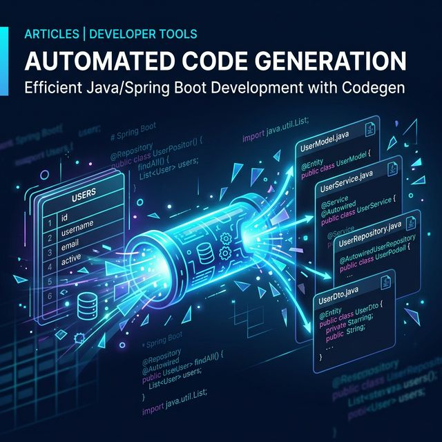
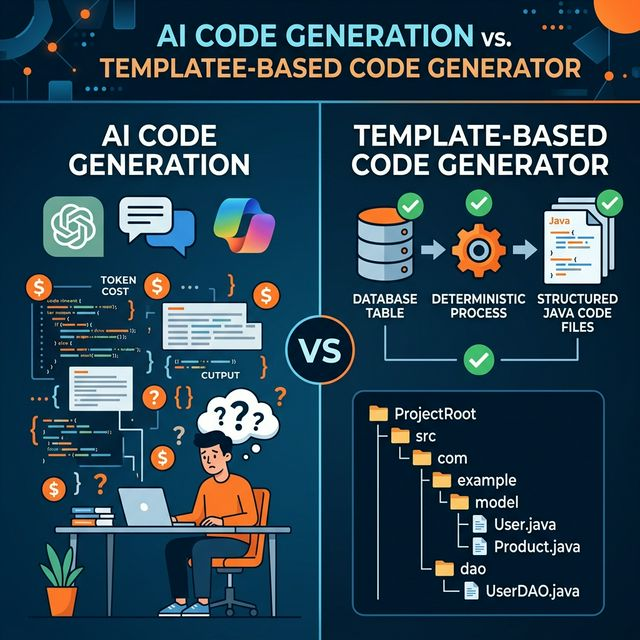
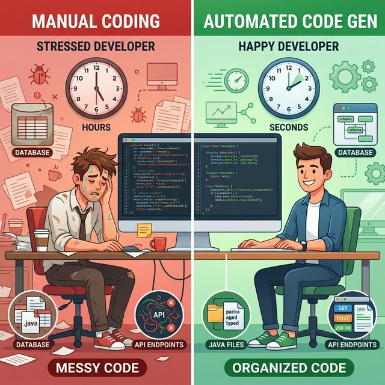
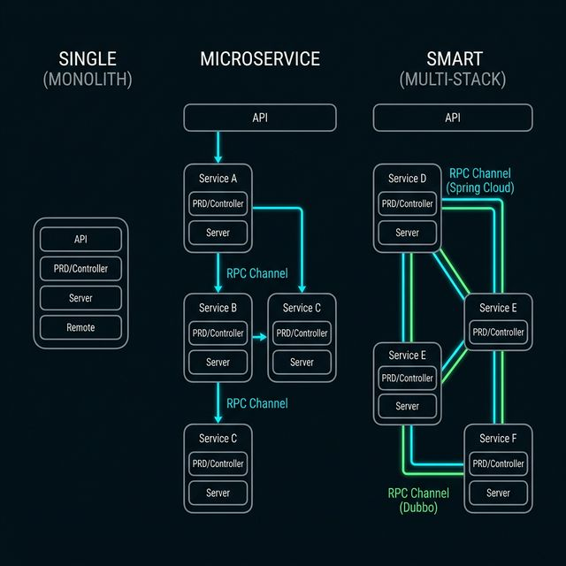
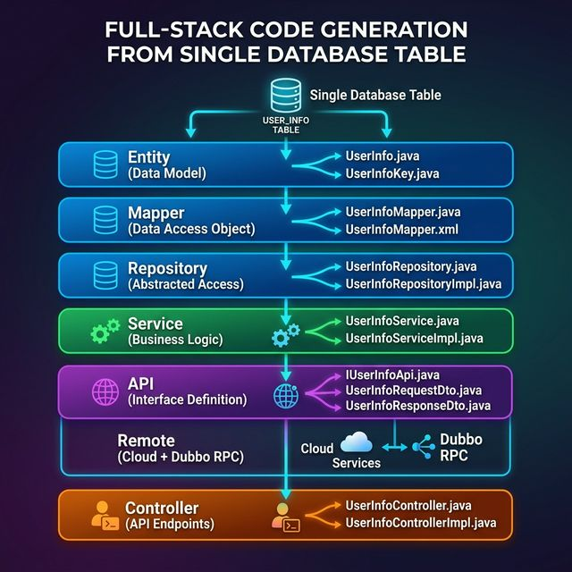
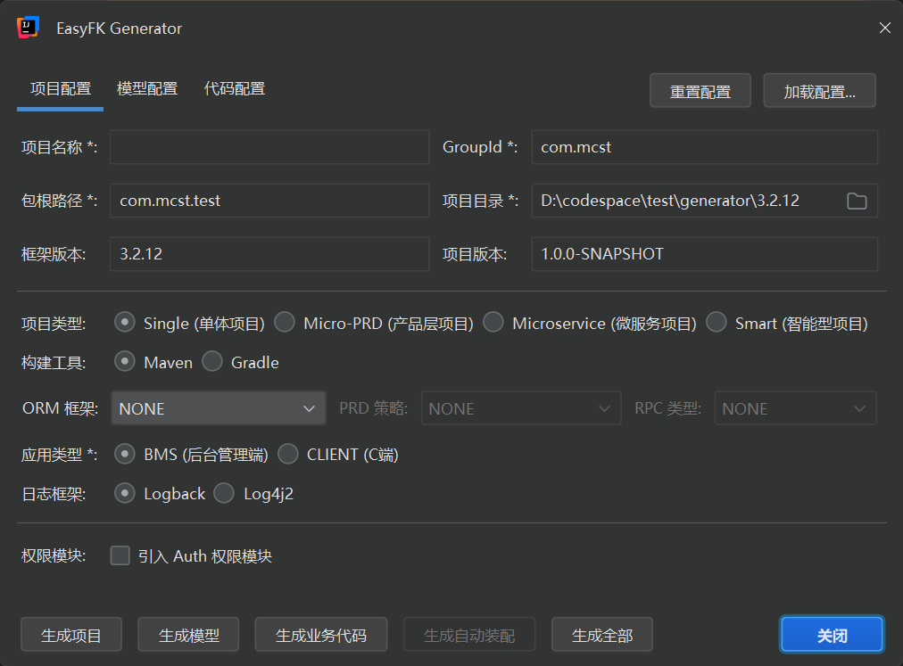
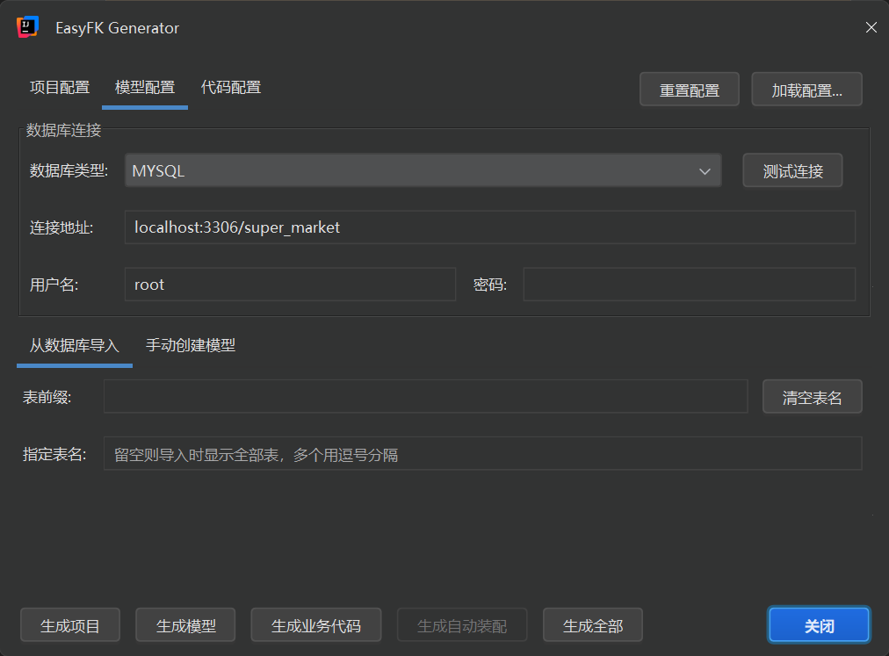
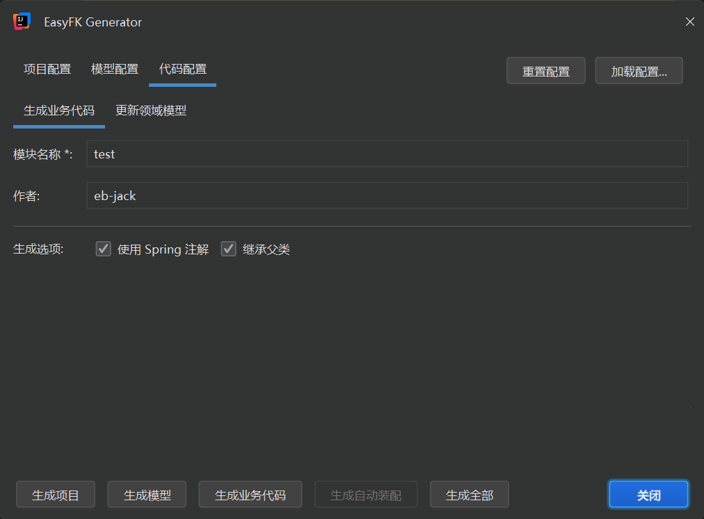

# AI 写代码都这么强了，这个 Java 代码生成工具凭什么还能封神？

> **我用 AI 编程写了一周的微服务项目，最后发现还不如一个命令行工具跑 3 秒钟。**



---

"AI 写代码已经这么强了，谁还用代码生成器啊？"

这句话我去年也深信不疑。

直到我接了一个 **30 张数据库表的微服务项目** — 用 ChatGPT 逐个表生成 Entity、Mapper、Service、Controller、DTO、Remote……**光提示词就写了上万字，Token 烧了几百块，生成的代码风格还前后不一致，build.gradle 依赖关系全是错的。**

最后整整 debug 了两天，才把 AI 生成的代码跑通。

然后同事拿了一个叫 **EasyFK Generator** 的工具，改了几行 YAML 配置，敲了一个 `efg` 命令——

**3 秒。**

**30 张表，450+ 个 Java 文件，完整的 SMART 微服务架构，构建文件、启动类、配置文件一个不少，直接导入 IDEA 就能跑。**

那一刻我才真正理解：**AI 编程和代码生成器，根本不是一回事。**

如果你也是 Java 开发者，如果你也在用 ChatGPT / Claude / Gemini 写后端代码，**这篇文章可能会颠覆你的认知。**

---

## 🎯 先说痛点：Java 后端开发者的日常崩溃

作为 Java 开发者，你一定经历过这样的场景：

- 📋 **新项目启动**：花了一整天搭建项目骨架、配置 Maven/Gradle、创建各种包结构……
- 🔄 **新增业务表**：又要写 Entity → Mapper → Repository → Service → Controller，重复到怀疑人生
- 😤 **多人协作**：每个人的代码风格不一样，命名规范混乱，字段映射出错
- ⏰ **需求频繁变更**：数据库表结构改了，DTO、Param 类又要手动同步……
- 🤖 **求助 AI**：让 GPT / Claude 生成代码，结果每次输出都不一样，注解用错、基类搞混、构建文件跑不通……

**你以为 AI 是救星？它可能只是换了一种方式折磨你。**

---

## 🤖 AI 编程时代，为什么还需要代码生成器？

> **"有了 ChatGPT / Claude / Gemini，还需要代码生成器吗？"**
>
> 这可能是你看到标题后的第一个疑问。答案是：**不仅需要，而且在企业级场景下，代码生成器是 AI 编程无法替代的。**



AI 大模型（ChatGPT、Claude、Gemini、DeepSeek 等）已经席卷了整个开发者社区，用 AI 写代码已成为当下主流。但当你真正用它来**批量生成企业级 Java 后端代码**时，你会发现一系列棘手的问题。

让我们来一次正面交锋 👇

### 🔴 AI 编程的 5 大痛点

#### 痛点 1：海量 Token 消耗 = 真金白银 💸

让 AI 生成一个完整的微服务项目代码，你需要：

- 📝 编写**长篇精准的提示词** — 描述每一层的代码规范、命名规则、继承关系、注解要求……
- 🔄 **多轮对话反复调整** — "这个类名不对"、"注解用错了"、"缺少 XML 文件"、"Service 层的泛型参数不对"……
- 💰 每一轮对话都在消耗 Token，**10 张表的完整代码可能需要数万甚至十万+ Token**

按 GPT-4o / Claude 的价格计算，**一个项目的代码生成成本可能高达几十到上百元**，而且每次新建项目都要重新消耗。更别提很多企业项目动辄几十上百张表，Token 成本将会是一笔惊人的开支。

> 💡 **EasyFK Generator：零 Token 消耗。** 基于本地 Freemarker 模板引擎，完全离线运行，生成 100 张表的代码成本 = **0 元**。

#### 痛点 2：输出不确定 — 每次生成的代码都不一样 🎲

AI 的本质是**概率模型**——同样的提示词，输出结果并不稳定：

- 今天生成的 Service 用了 `@Service` 注解，明天可能忘了加
- 这次继承了 `BaseService`，下次可能用了完全不同的基类
- 字段映射规则前后不一致，`DATETIME` 有时映射成 `Date`，有时映射成 `LocalDateTime`
- 代码风格、缩进、注释格式**每次都可能不同**
- 同一个项目中 AI 生成的 10 个 Service 实现，**可能风格各异**

这在团队协作中是**灾难性的** — 你永远无法确定 AI 生成的代码是否与项目现有规范一致。

> 💡 **EasyFK Generator：100% 确定性输出。** 相同配置 = 相同代码。60+ 个经过严格验证的 Freemarker 模板确保每一行代码都精确可控，10 张表生成的代码风格**完全一致**。

#### 痛点 3：架构感知为零 — AI 不理解你的项目结构 🏗️

AI 能帮你写一个 Controller，但它**不知道**：

- 你的项目是单体还是微服务？是 Spring Cloud 还是 Dubbo？
- API 接口应该放在哪个模块？Remote 实现应该放在哪个子项目？
- AutoConfiguration 怎么配置？模块间的依赖关系怎么组织？
- `build.gradle` / `pom.xml` 应该怎么写？各模块的依赖声明是否正确？
- 哪些代码放在 `xxx-server` 模块？哪些放在 `xxx-api` 模块？哪些放在 `xxx-cloud-provider`？

**AI 只能生成代码片段，不能生成完整的、结构正确的多模块工程。** 你仍然需要手动组织项目结构、配置构建文件、处理模块间依赖 — 而这恰恰是最耗时、最容易出错的环节。

> 💡 **EasyFK Generator：架构感知、全局编排。** 它深度理解 SINGLE / MICROSERVICE / SMART 等架构形态的完整结构，一键生成包含**所有子模块、构建文件、启动类、配置文件**的完整工程 — 不是代码片段，而是一个**可以直接导入 IDEA 运行的项目**。

#### 痛点 4：框架集成断层 — AI 不了解你的框架生态 🔌

AI 的训练数据中不包含你的私有框架，它不知道：

- 你的 Entity 应该继承 `BaseMyBatisPlusEntity` 还是 `BaseMyBatisPlusSimpleEntity`
- `@AutoMapper` 注解的正确用法和目标类型
- `IBaseRepository`、`IBaseService`、`IBaseApi` 的泛型参数顺序
- 框架自定义注解 `@SingleUniqueField`、`@BetweenConditionField` 的语义和联动生成逻辑
- `IBaseRemote` 和 `IDubboBaseRemote` 的区别

每次都需要**在提示词中重复描述**这些框架细节，稍有遗漏就会生成错误的代码。而你可能要到编译甚至运行时才能发现——**调试 AI 生成的错误代码所花的时间，可能比手写还长**。

> 💡 **EasyFK Generator：与 EasyFK 框架深度耦合。** 60+ 个模板内置了所有框架约定，生成的代码与框架基类、注解、通用能力**无缝集成**，开箱即用无需调试。

#### 痛点 5：增量生成不可能 — AI 无法管理文件生命周期 📂

项目初始化后，当你新增业务表或需要同步数据库变更时：

- AI **无法判断**哪些文件已经存在、哪些需要新建
- AI **无法决定**哪些文件应该覆盖更新、哪些应该保留你的手动修改
- AI **无法做到**只刷新 DTO/Param 而不影响 Service/Controller
- 你不得不**手动管理**每一个文件的创建、更新和保护
- 一不小心让 AI 重新生成了某个 Service，你花了两天写的业务逻辑就**灰飞烟灭**了

> 💡 **EasyFK Generator：内置智能文件策略。** `createOnNotExistFile` 保护手动修改，`delAndCreateFile` 同步数据库变更，`updateDtoAndParam()` 精准刷新 — 一切自动化，**你写的每一行业务代码都安全无虞**。

---

### 🟢 正面对决：完整维度对比表

| 维度 | 🤖 AI 编程 | ⚙️ EasyFK Generator |
|:---:|:---|:---|
| **Token / 成本** | 每次生成消耗大量 Token，按量计费 💸 | 零成本，本地离线运行 ✅ |
| **提示词复杂度** | 需要精准描述每层规范、注解、继承关系 😫 | 一份 YAML 配置搞定一切 ✅ |
| **输出确定性** | 概率模型，每次输出可能不同 ❌ | 模板驱动，100% 确定性输出 ✅ |
| **代码规范一致性** | 无法保证跨文件/跨模块风格统一 ❌ | 60+ 模板强制统一规范 ✅ |
| **架构感知** | 只能生成代码片段，不理解项目整体 ❌ | 理解 4 种架构形态，生成完整工程 ✅ |
| **多模块工程** | 无法生成构建文件和模块依赖关系 ❌ | Maven/Gradle 构建文件自动生成 ✅ |
| **框架集成** | 不了解私有框架的基类/注解/约定 ❌ | 与 EasyFK 框架深度集成 ✅ |
| **增量生成** | 无文件管理能力，容易覆盖手动修改 ❌ | 智能文件策略，安全增量 ✅ |
| **数据库感知** | 需要手动描述表结构信息 ❌ | 直连数据库，自动解析 22 种数据库 ✅ |
| **团队协作** | 每个人的提示词不同 → 风格差异 ❌ | 同一份配置 → 统一输出 ✅ |
| **离线可用** | 依赖网络和 API 服务 ❌ | 完全离线运行 ✅ |
| **可复现性** | 无法精确复现相同输出 ❌ | 配置 + 模板 = 100% 可复现 ✅ |
| **生成速度** | 受限于 API 响应速度和限流 🐢 | 本地秒级生成，无限流 ✅ |
| **数据安全** | 代码/表结构发送到第三方服务器 ⚠️ | 纯本地运行，数据不出局域网 ✅ |

---

### 💡 并非对立，而是互补——最佳开发范式

**我们并不是说 AI 编程没有价值** — 恰恰相反，在以下场景中 AI 编程依然无可替代：

- ✅ 编写**复杂业务逻辑**（如算法、数据处理、特殊业务规则）
- ✅ **代码 Review 和优化建议**
- ✅ **调试和排错**（定位 Bug、分析异常堆栈）
- ✅ 编写**单元测试**
- ✅ **技术调研和学习**

但对于**结构化、规范化、重复性的基础设施代码**，代码生成器是碾压级的更优解。

> 🎯 **当下最高效的 Java 开发范式：**
>
> **EasyFK Generator 生成 80% 的基础架构代码**（Entity、Mapper、Repository、Service、Controller、DTO、Remote、构建文件、配置文件……）
>
> **+ AI 辅助编写 20% 的业务创新代码**（复杂查询逻辑、数据处理、业务规则、算法实现……）
>
> **两者结合，效率拉满，质量拉满。** 这才是完整的工程化解决方案。

---

而 **EasyFK Generator** 正是为此而生 — 它不是简单的模板填充工具，而是一个**企业级、全栈覆盖、配置驱动**的智能代码生成引擎。

---

## 💡 EasyFK Generator 是什么？

**EasyFK Generator** 是 **易架构（EasyFK）** 框架体系的核心基础设施，面向 Java / Spring Boot 技术栈的企业开发团队，提供 **一站式代码生成能力**。

> **一次配置，全栈生成。** 从项目骨架到完整业务代码，分钟级交付生产就绪的 Java 工程。

### 🔑 一句话总结它能做什么：

**你给它一张数据库表，它还你 8~15 个标准化 Java 文件 — 从 Entity 到 Controller，从 Spring Cloud 到 Dubbo，一个不落。**



---

## 🏗️ 核心特性：不只是 CRUD，它重新定义了"全栈生成"

### ✅ 特性一：三种架构形态，一键切换

不同项目，不同架构。EasyFK Generator 不绑定某一种项目形态，而是让你**一行配置**自由切换：

| 架构类型 | 适用场景 | 生成产物 |
|:------:|:------:|:------:|
| **SINGLE（单体）** | 中小型项目、快速原型 | 单一工程，所有代码集中 |
| **MICROSERVICE（微服务）** | 标准微服务拆分 | API + Server + PRD 模块 |
| **SMART（多栈微服务）** | 大型平台、多协议互通 | 同时生成 Spring Cloud 和 Dubbo 双通道 |

```yaml
easyfk.config.generator.project:
  project-type: smart  # 切换架构？改这一行就够了
```



> 💬 **这意味着什么?** 
> 
> 你的项目可以从单体架构起步，当业务发展到一定规模需要拆分微服务时，**只需修改一行配置重新生成**，不用推翻重来。这在企业项目中的价值无可估量。

---

### ✅ 特性二：一张表 → 15+ 个标准化 Java 文件

这是 EasyFK Generator 最令人震撼的能力 — **完整分层代码，全栈覆盖**。

以 `Product`（商品）为例，SMART 架构下一次生成的完整产物：

```
数据库表 Product
  ├── 📦 Entity（实体类，含字段映射与注解）
  ├── 📦 Mapper（MyBatis 接口 + XML 映射）
  ├── 📦 Repository + Impl（数据仓储层）
  ├── 📦 Service + Impl（业务逻辑层）
  ├── 📦 API 接口（SMART 架构核心抽象）
  ├── 📦 DTO / Param / Req / Resp / EditReq（数据传输对象全家桶）
  ├── 📦 Spring Cloud Remote + Impl（Feign 远程调用）
  ├── 📦 Dubbo Remote + Impl（Dubbo 远程调用）
  └── 📦 Controller（RESTful 接口层）
```



> 🤯 **15+ 个文件，每一个都遵循统一编码规范，开箱即用！**

更直观地看看生成后的项目结构：

```
my-app/
├── my-app-api/                           # API 定义模块
│   └── dto/ param/ request/ response/    # 数据传输对象全集
│
├── my-app-server/                        # 服务实现模块
│   └── persistence/ repository/ service/ # 完整业务链路
│
├── my-app-remote/                        # 远程调用模块
│   ├── my-app-cloud-api/                 # Spring Cloud 客户端
│   ├── my-app-cloud-provider/            # Spring Cloud 实现
│   ├── my-app-dubbo-api/                 # Dubbo 客户端
│   └── my-app-dubbo-provider/            # Dubbo 实现
│
├── my-app-prd-client/                    # C 端 Controller
└── my-app-prd-bms/                       # B 端管理 Controller
```

---

### ✅ 特性三：数据库感知 — 直连数据库，智能解析

EasyFK Generator 不是简单的模板工具。它能**直连数据库**，自动完成从表结构到 Java 代码的完整映射：

- 🔍 **自动读取表结构** — 字段名、类型、注释、主键，一个不漏
- 🧠 **智能类型映射** — `DATETIME` → `LocalDateTime`，`DECIMAL` → `BigDecimal`
- 🏷️ **注解感知** — 识别 Entity 上的自定义注解，自动在各层生成对应逻辑
- ✂️ **表前缀处理** — `base_product` 自动变成干净的 `Product` 类名

**支持多达 22 种数据库！** 不仅包含 MySQL、PostgreSQL、Oracle、SQL Server 等主流数据库，还覆盖了**达梦、人大金仓、南大通用、神通**等国产信创数据库。

| 类别 | 数据库 |
|:---:|:---:|
| **主流关系型** | MySQL、MariaDB、PostgreSQL、Oracle、SQL Server |
| **国产信创** | 达梦（DM）、人大金仓、南大通用、神通、虚谷 |
| **分布式/云原生** | OceanBase、ClickHouse、GaussDB |
| **嵌入式/其他** | H2、HSQL、SQLite、DB2、Firebird |

> 💡 **信创项目的福音！** 如果你的团队正在做国产化适配，EasyFK Generator 天然支持，无缝切换。

---

### ✅ 特性四：增量生成 — 安全可控，绝不覆盖你的代码

很多开发者对代码生成器心存顾虑：**"它会不会把我手动写的代码覆盖掉？"**

EasyFK Generator 贴心地设计了两种文件策略：

| 策略 | 适用文件 | 行为 |
|:---:|:---:|:---:|
| 🛡️ **不存在才创建** | Service、Controller、Mapper XML 等 | 已有文件**绝不覆盖** |
| 🔄 **强制刷新** | Entity、DTO、Param | 每次生成都**与数据库同步** |

**你的手动修改永远是安全的。** Service 实现、Controller 逻辑、Mapper XML — 这些文件一旦生成就不会被覆盖，你可以自由添加自定义业务逻辑。

---

## 🛠️ 两种使用方式，满足不同习惯

### 方式一：IntelliJ IDEA 插件 — 零学习成本（推荐）

EasyFK Generator 提供了专业的 **IDEA 插件**，可视化操作，无需手写任何配置文件：

**▶ 插件安装：**
1. 打开 IDEA → `File → Settings → Plugins → Marketplace`
2. 搜索 **EasyFK Generator**
3. 点击 Install，重启 IDE 即可使用

> 也可以从 [JetBrains 插件市场](https://plugins.jetbrains.com/plugin/30796-easyfk-generator/versions#tabs) 手动下载安装。

**▶ 项目配置界面 — 选择架构、构建工具、ORM 框架等：**



**▶ 模型配置界面 — 连接数据库、导入表结构：**



**▶ 代码配置界面 — 设置模块名、作者等：**



**插件核心特性：**
- 🎨 **可视化配置** — 对话框式操作，无需手写 YAML
- 🗄️ **数据库导入** — 可视化连接数据库，勾选表即自动生成模型定义
- ⚡ **分步生成** — 项目骨架 / 模型 / 业务代码 / 自动装配，按需生成
- 💾 **配置持久化** — 自动保存配置，下次打开自动加载
- ⌨️ **快捷键支持** — `Ctrl + Alt + Z` 一键打开

**插件入口速览：**

| 入口 | 说明 |
|:---:|:---:|
| File → New → **EasyFK Project** | 新建项目 |
| Generate → **EasyFK 增量生成** | 增量生成（`Ctrl + Alt + Z`） |
| Generate → **EasyFK 刷新模型** | 表结构变更后刷新 Entity |
| Generate → **EasyFK 刷新 DTO/Param** | 仅刷新数据传输对象 |
| 右侧工具窗口 → **EasyFK** | 按场景分组的快捷操作面板 |

---

### 方式二：CLI 命令行工具 — 适合自动化场景

不依赖 IDE，一条命令搞定一切，特别适合 CI/CD 流程和自动化场景！

```bash
# 1. 安装（解压后一键安装）
Windows：双击 install.bat
macOS/Linux：chmod +x install && ./install

# 2. 验证
efg -V
# 输出：easyfk-generator 3.2.12

# 3. 初始化配置
mkdir my-project && cd my-project
efg init

# 4. 编辑 generator.yml（填入项目信息和数据库配置）

# 5. 一键全量生成！
efg
```

**CLI 命令速查表：**

| 命令 | 说明 |
|:---:|:---:|
| `efg` | 🚀 全量生成（项目骨架 + Entity + 业务代码 + 装配） |
| `efg -p` | 仅生成项目骨架 |
| `efg -m` | 仅生成 Entity + Mapper |
| `efg -s` | 仅生成业务代码 |
| `efg -a` | 仅生成自动装配配置 |
| `efg -d` | 仅刷新 DTO / Param |
| `efg -pm` | 项目骨架 + Entity（新项目第一步） |
| `efg -sa` | 业务代码 + 自动装配（新增业务表后） |

---

## 📐 三分钟快速上手：从零到完整项目

让我们实际演示一下，看看 EasyFK Generator 是如何让你**三分钟拥有一个完整的微服务项目**的。

### 第一步：添加依赖（如果使用编程方式）

**Gradle:**
```groovy
implementation 'com.mcst:easyfk-generator:3.2.12'
```

**Maven:**
```xml
<dependency>
    <groupId>com.mcst</groupId>
    <artifactId>easyfk-generator</artifactId>
    <version>3.2.12</version>
</dependency>
```

### 第二步：编写配置

```yaml
easyfk:
  config:
    generator:
      project:
        project-dir: D:\workspace\projects
        group-id: com.example
        project-name: my-shop
        project-type: smart            # SMART 多栈微服务
        prd-type: separation           # 前后端分离（C端 + B端）
        build-type: gradle             # Gradle 构建
        orm-type: MYBATIS              # MyBatis-Plus
        base-package: com.example.shop
        framework-version: 3.2.12
      code:
        module-name: shop
        db-short-url: localhost:3306/my_shop
        db-user: root
        db-pwd: 123456
        table-prefix: t_
        db-tables: t_product,t_order,t_payment
        model-list:
          - model-name: Product
            model-desc: 商品信息
          - model-name: Order
            model-desc: 订单信息
          - model-name: Payment
            model-desc: 支付记录
            create-controller: false   # 支付记录不需要 Controller
```

### 第三步：一键生成！

```java
@Resource
private EasyfkGenerator easyfkGenerator;

// 全量生成 — 一行代码搞定一切
easyfkGenerator.generateAll();
```

或者使用 CLI：

```bash
efg
```

> ⚡ **就是这么简单！** 3 张数据库表 → 45+ 个标准化 Java 文件 → 完整的 SMART 微服务项目 → 开箱即用！

---

## 🔥 EasyFK Generator 的独特价值

### 📊 三方效率对比：手动编码 vs AI 编程 vs EasyFK Generator

| 维度 | ✍️ 手动编码 | 🤖 AI 编程 | ⚙️ EasyFK Generator |
|:---:|:---:|:---:|:---:|
| 一张表的全栈代码 | **2~4 小时** | 30~60 分钟（含调试） | **几秒钟** ⚡ |
| 新项目从零搭建 | **1~2 天** | 2~4 小时（反复提示） | **3 分钟** ⚡ |
| 架构切换（单体→微服务） | **3~5 天** 重构 | 无法自动完成 ❌ | **改一行配置** ⚡ |
| 代码规范一致性 | 靠人工 Review | 无法保证 ❌ | **100% 一致** ✅ |
| 数据库表结构变更同步 | 手动改N个文件 | 需重新描述表结构 | **一键刷新** ⚡ |
| 生成成本 | 人力成本 | Token 费用累积 💸 | **零成本** ✅ |
| 生成结果可复现 | 取决于个人 | 不可复现 ❌ | **100% 可复现** ✅ |
| 构建文件生成 | 手动配置 | 经常出错 ❌ | **自动适配** ✅ |
| 离线可用 | ✅ | 依赖网络 ❌ | **完全离线** ✅ |

### 🏆 核心优势

| 优势 | 价值 |
|:---:|:---:|
| **效率提升 10x+** | 数小时的重复工作缩短至秒级 |
| **规范统一** | 消除团队协作中的代码风格差异 |
| **架构灵活** | 单体 → 微服务 → 多栈，自由演进 |
| **安全可控** | 增量策略保护手动修改，绝不覆盖 |
| **信创兼容** | 覆盖达梦、金仓等 22 种数据库 |
| **生态完备** | 深度集成 EasyFK 框架，权限/基类开箱即用 |
| **零成本运行** | 无 Token 消耗，无 API 费用，完全离线 |
| **AI 最佳搭档** | 生成器搞定 80% 基础代码，AI 聚焦 20% 业务创新 |

---

## 🎯 谁适合使用 EasyFK Generator？

| 场景 | 说明 |
|:---:|:---:|
| 🚀 **新项目快速启动** | 定义好数据库表，一键生成完整项目和代码 |
| 🔀 **微服务拆分** | 从单体无缝迁移到微服务架构 |
| 📦 **业务模块扩展** | 在已有项目中快速新增模块，保持架构一致 |
| 🏛️ **信创适配** | 国产化环境项目天然支持 |
| 👥 **团队规范落地** | 通过生成器强制统一团队编码规范 |
| ⚡ **原型验证** | 快速搭建可运行的业务原型，加速产品验证 |

---

## 📋 技术规格一览

| 项目 | 规格 |
|:---:|:---:|
| Java 版本 | **Java 21** |
| Spring Boot | **3.x** |
| 模板引擎 | Freemarker 2.3.31 |
| ORM 框架 | MyBatis-Plus / MyBatis-Flex / Hibernate |
| RPC 框架 | Spring Cloud / Apache Dubbo |
| 构建工具 | Maven / Gradle (Groovy & Kotlin DSL) |
| 模板数量 | **60+** 个 Freemarker 模板 |
| 支持数据库 | **22 种** |
| 当前版本 | **3.2.12** |

---

## 🧩 智能注解系统 — 生成器能"读懂"你的 Entity

EasyFK Generator 不只是简单地生成 CRUD 代码。当你在 Entity 中添加框架提供的**自定义注解**时，生成器会智能解析并在各层自动生成对应的业务逻辑：

### ① `@SingleUniqueField` — 单字段唯一校验
```java
@SingleUniqueField(repetitionMsg = "商品名称已存在")
private String productName;
// 📌 效果：save 时自动校验唯一性
```

### ② `@CombUniqueField` — 组合唯一校验
```java
@CombUniqueField(repetitionMsg = "该分类下已存在同名商品", 
                 combinationField = "categoryId")
private String productName;
// 📌 效果：productName + categoryId 组合唯一校验
```

### ③ `@BetweenConditionField` — 区间查询
```java
@BetweenConditionField
private LocalDateTime createTime;
// 📌 效果：Param 中自动生成 createTimeStart / createTimeEnd
```

### ④ `@ForbiddenField` — 启用/禁用
```java
@ForbiddenField(value = "forbidden")
// 📌 效果：Controller 自动生成启用/禁用接口
```

> 🤓 **这不是简单的模板替换 — 这是真正的"理解代码"。**

---

## 🎊 结语：让架构师的设计直接变成可运行的代码

EasyFK Generator 的目标从来不是取代开发者，而是**释放开发者的创造力**。

它帮你处理那些**重复的、规范化的、有固定模式的**代码，让你可以把宝贵的时间和精力投入到**真正有挑战性的业务逻辑**中去。

> **一次配置，全栈生成。**
> 
> **一张表，15 个文件。**
> 
> **一行改动，架构切换。**
> 
> 这就是 EasyFK Generator — **让代码生成回到它应有的样子。**

---

### 📥 立即体验

> 🌐 **更多详细介绍和使用方法，请访问官网：**
>
> ### 👉 [https://easybuild.pro/docs/reader](https://easybuild.pro/docs/reader)

- **IDEA 插件安装：** [JetBrains 插件市场 — EasyFK Generator](https://plugins.jetbrains.com/plugin/30796-easyfk-generator/versions#tabs)
- **CLI 工具：** 获取 `efg-3.2.12.zip` 安装包，解压后一键安装
- **环境要求：** JDK 21+，IntelliJ IDEA 2023.1+（插件方式）

---

*📢 如果这篇文章对你有帮助，别忘了 **点赞 + 收藏 + 转发**，让更多 Java 开发者告别重复劳动！*

*💬 有任何问题或建议，欢迎在评论区留言交流~*
